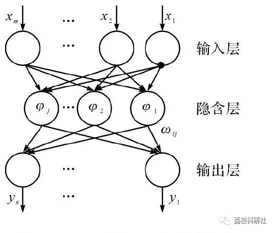
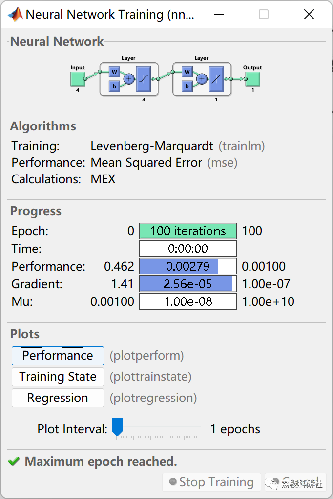
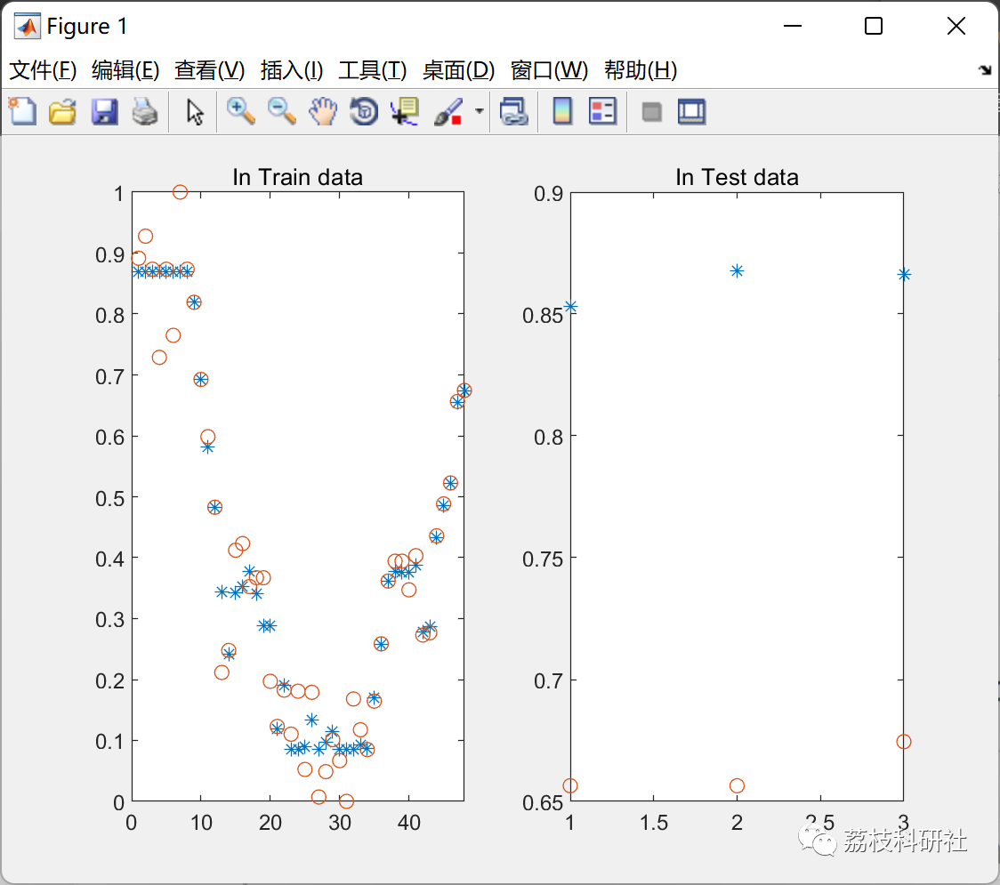
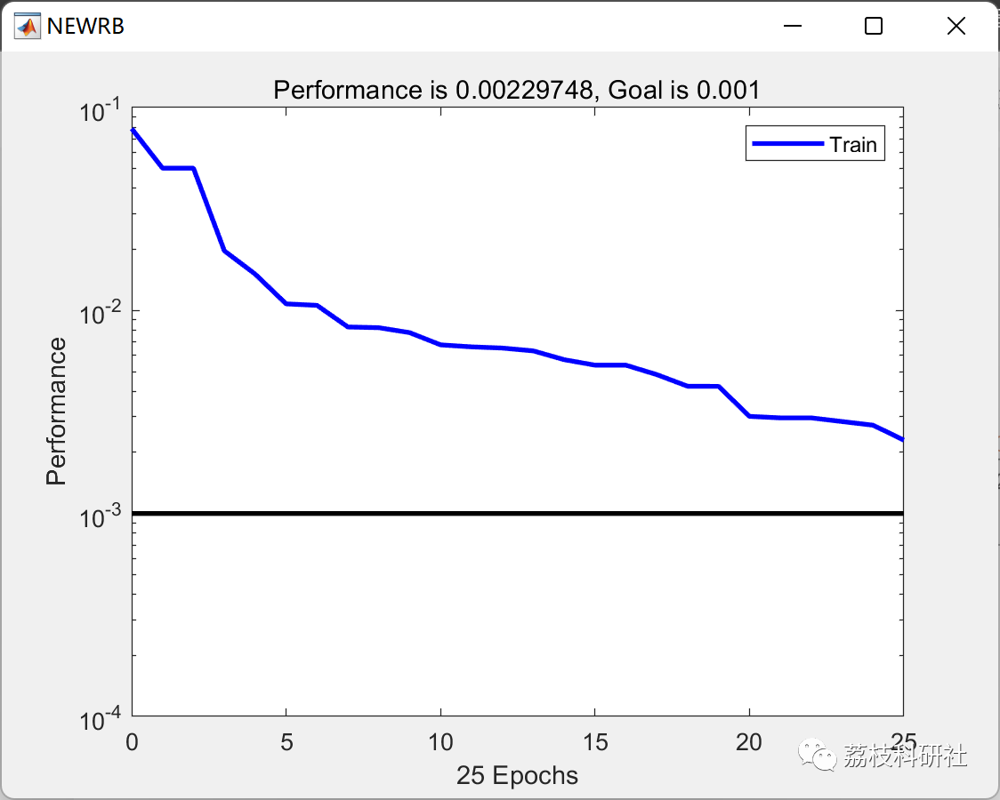
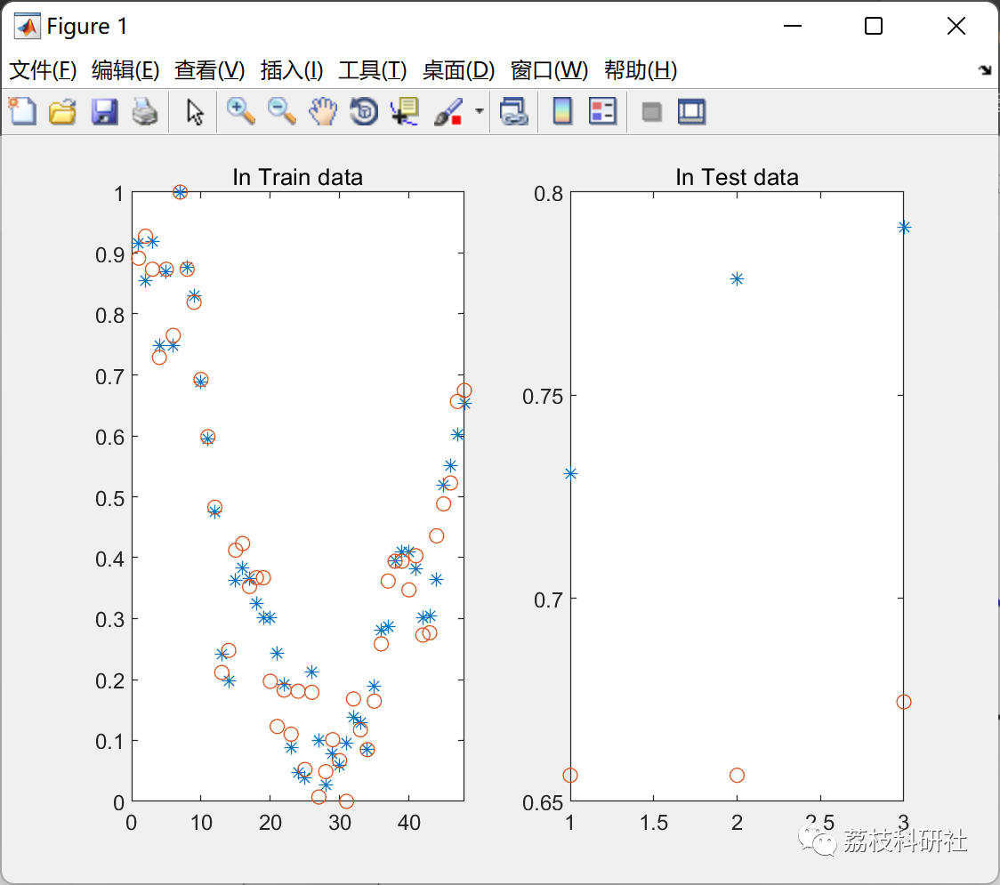
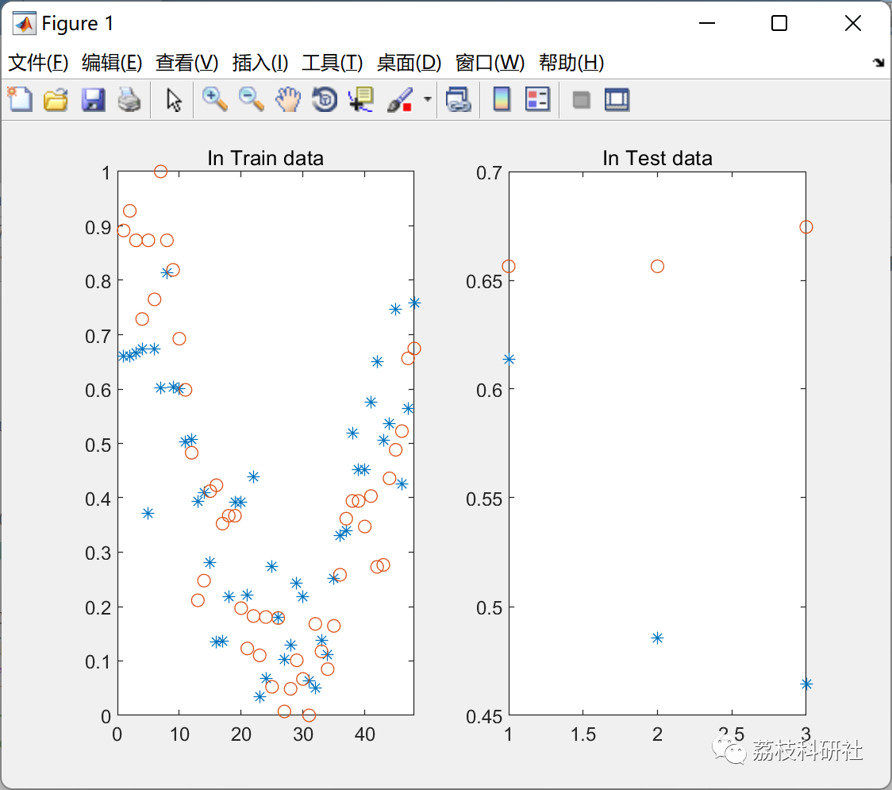
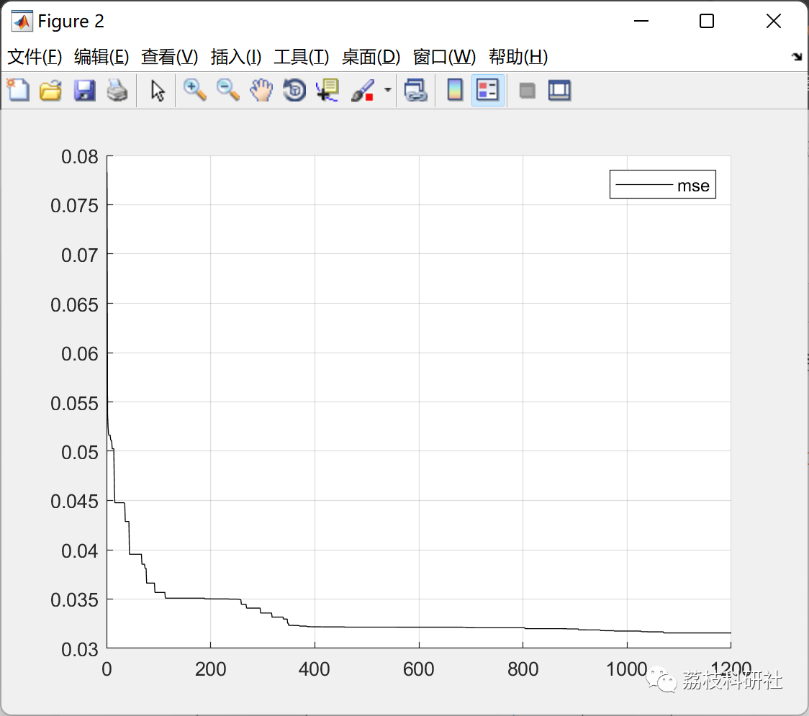

# Prediction of data based on BP neural network, RBF neural network and PSO-optimized RBF neural network (Matlab code implementation)

💥💥💥💞💞💞 Welcome to this blog❤️❤️❤️ 💥💥💥
🏆 Bloggers' Advantages: 🌞🌞🌞 The content of the blog strives for rigorous thinking and clear logic to facilitate readers.
⛳️ Mantra: "A journey of a thousand miles begins with a single step."
Litchi Research Society
Code Collection: Power Systems, Intelligent Algorithms and Applications, Neural Network Prediction, Path Planning, Optimized Scheduling, Workshop Scheduling, Image Processing, Signal Processing...
🎁 Special Section Links: ​
🌈🌈🌈🌟🌟🌟 Electrical Code Intelligent Algorithms and Their Applications Path Planning Neural Network Prediction Optimized Scheduling Image Processing Workshop Scheduling Signal Processing Romantic Her Thoughts Math Modeling Complete Code Issues
💥1 Overview
📚2 Run Results
2.1 BP Neural Network
2.2 RBF
2.3 PSO-RBF
🎉3 References
🌈4 MATLAB Code Realization
💥1 Overview
The RBF neural network structure generally includes an input layer, hidden layer, and the output layer of the neural network. The RBF neural network transforms complex nonlinear problems into high-dimensional feature spaces, converting them into linearly separable issues, avoiding local minima, and requires more hidden neurons. The structure of the RBF neural network is shown in Figure 1.
📚2 Run Results
2.1 BP Neural Network
2.2 RBF
2.3 PSO-RBF
🎉3 References
[1] Wang Yuanyuan. Research on greenhouse temperature prediction based on improved PSO optimization of RBF neural networks [J]. Computer and Digital Engineering, 2016, 44(07):1210-1215.
[2] Xiang Zhaojun. Research and Application of Group Intelligence Algorithm Optimization of RBF Neural Networks [D]. Lanzhou University, 2016. DOI:10.27204/d.cnki.glzhu.2016.000078.
🌈4 MATLAB Code Realization
Click the article's lower left corner to read more.

## Images

<!-- PAYMENT_BLOCK -->

## Get this dataset

- Payment link (Stripe): [Buy now](https://buy.stripe.com/3cs8yP7sY87d0vu9AB)
- Payment QR code: 

<!-- /PAYMENT_BLOCK -->
